# Relational Model

*   ENTITIES = TABLE
*   ATRIBUTES = COLUMNS IN THE TABLE
*   VALUES = VALUES IN THE ROWS
*   PRIMARY KEY = Unique attribute that identify a relationship between tables.
*   FOREING KEY = Are primary keys in other tables use to links tables.

# Type of SQL statements

1.  DDL = data definiton language:
    1.  Define, change, or drop data
        1.  CREATE = create a table.
            1.  **CREATE TABLE table\_name**
            2.  **(**
            3.  **column\_1 datatype = CHAR(2) PRIMARY KEY NOT NULL,**
            4.  **column\_2 datatype = VARCHAR(15) NOT NULL ,**
            5.  **column\_3 datatype = INT(50),**
            6.  **)**
        2.  ALTER =
            1.  Adding or remove columns.
            2.  Change data type of columns.
            3.  Add or remove keys.
            4.  Add or remove constraints.
                1.  **ALTER TABLE table\_name**
                2.  **ADD COLUMN column\_add DATATYPE,**
                3.  **..........,**
                4.  **ADD COLUMN column\_add9 DATATYPE;**
                5.  **\----------------------------------------------**
                6.  Sometimes, the data presented may be in a different format than required. In such a case, we need to modify the data\_type of the column. For example, using a numeric data type for telephone\_number means you cannot include parentheses, plus signs, or dashes as part of the number. For such entries, the appropriate choice of data\_type is CHAR.
                7.  **ALTER TABLE table\_name**
                8.  **MODIFY phone CHAR(20);**
        3.  TRUNCATE = delete data in the table, but leave the table.
            1.  **TRUNCATE TABLE table\_name IMEDIATE;**
        4.  DROP = use to delete tables.
            1.  **DROP TABLE table\_name;**
2.  DLM = data manipulation language:
    1.  Read and modify data. Work with the data in the table.
        1.  CRUD = create, read, update, delete rows.
        2.  INSERT = inster a row/s
        3.  SELECT = read a row/s
        4.  UPDATE = add a row/s
        5.  DELETE = delete a row/s

# Hands-on Lab: CREATE, ALTER, TRUNCATE, DROP

In this lab, you will learn how to create tables and load data using the phpMyAdmin graphical user interface (GUI) tool in the MySQL database service.

Software Used in this Lab In this lab, you will use MySQL. MySQL is a Relational Database Management System (RDBMS) designed to efficiently store, manipulate, and retrieve data.

To complete this lab, you will use MySQL relational database service available as part of IBM Skills Network Labs (SN Labs) Cloud IDE. SN Labs is a virtual lab environment used in this course.

Objectives After completing this lab, you will be able to use phpMyAdmin with MySQL to:

*   Create a database.
*   Insert records into a table.
*   Create a new table in a database.
*   Add, delete, or modify columns in an existing table.
*   Remove all rows from an existing table without deleting the table itself.
*   Delete an existing table in a database.

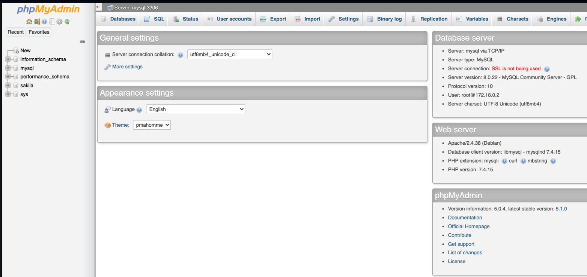

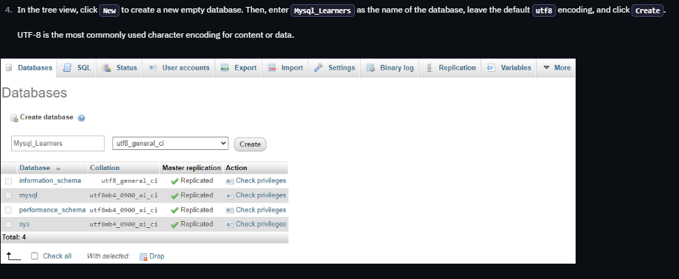

## CREATE statement

Now, you will use the CREATE statement to create two new tables. Follow the instructions to complete this task.

You need to create two tables, PETSALE and PET. To create the two tables, copy the code below and paste it into the text area of the SQL tab. Click Go.

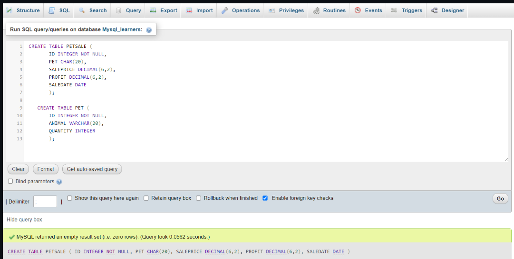

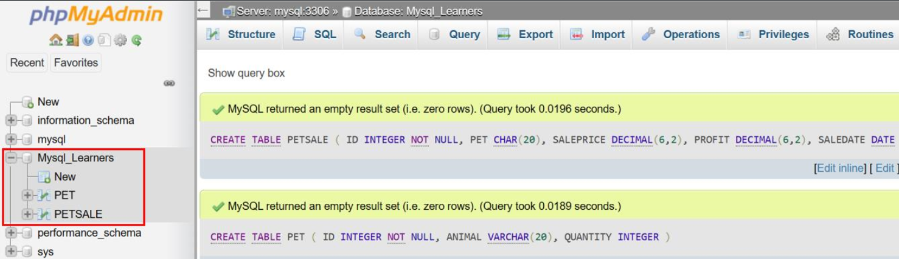

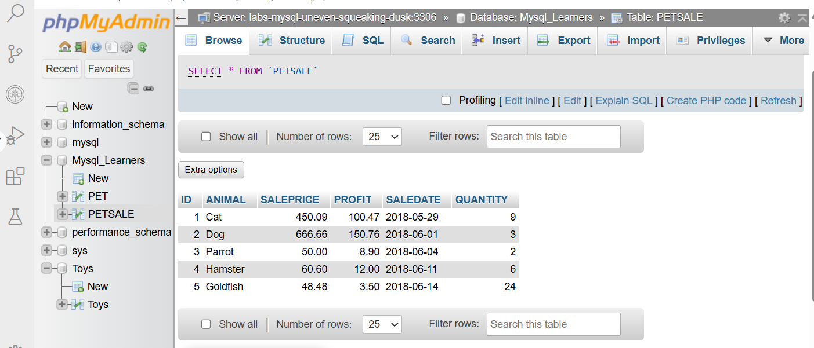

## INSERT statement

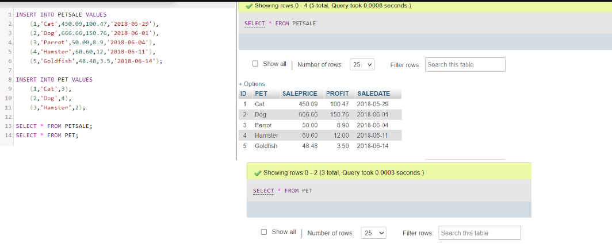

## ALTER statement

1.  Adding a column. Add a new column named QUANTITY to the PETSALE table and display the altered table. For this, copy the code below and paste it into the text area of the SQL page. Click Go.

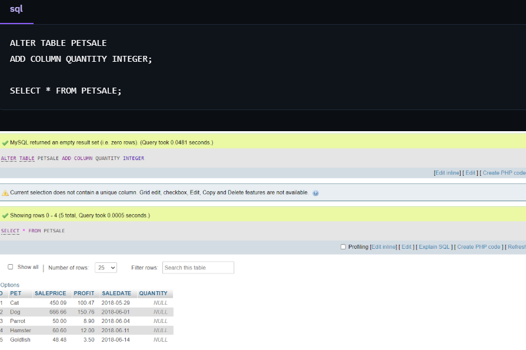

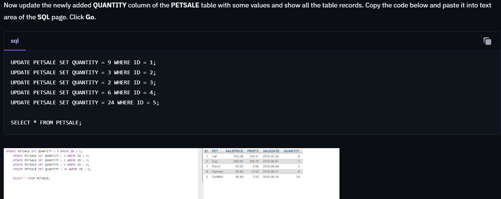

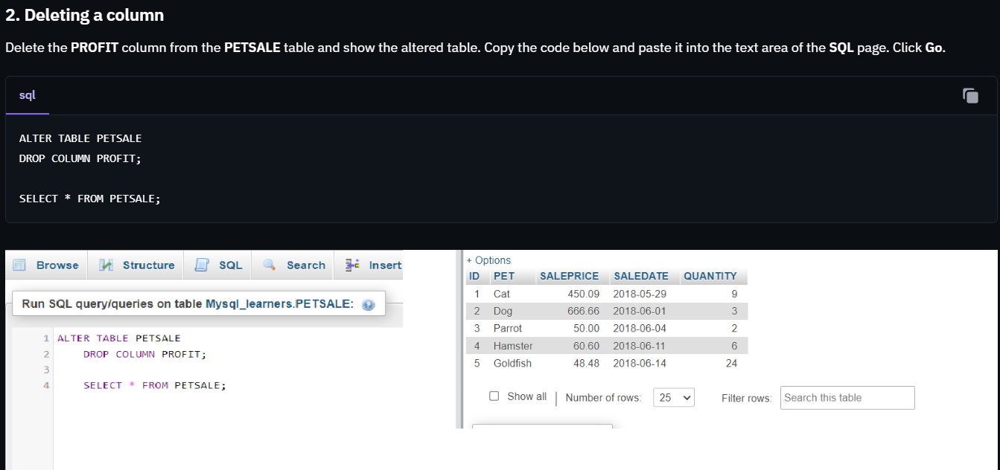

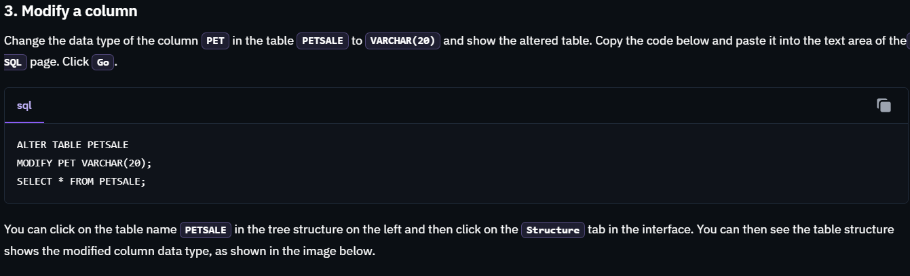

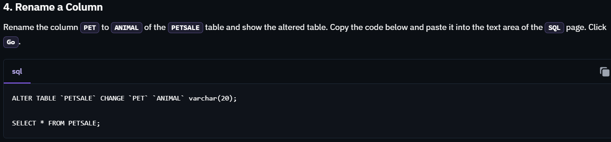
