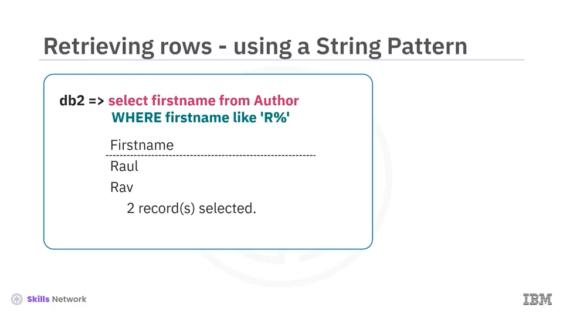

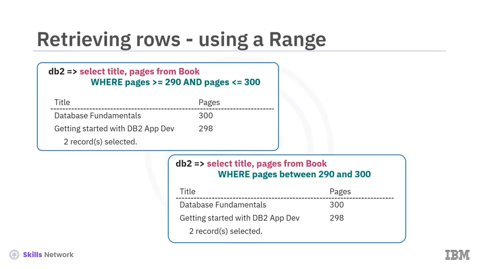

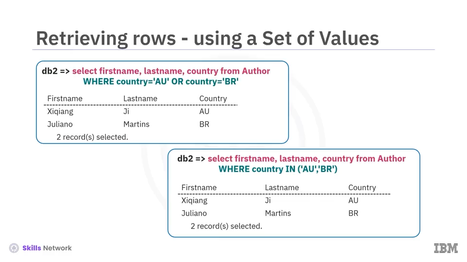

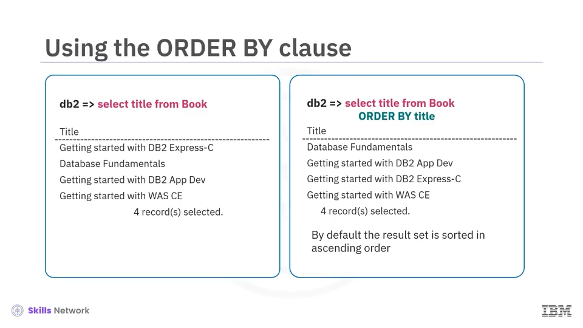

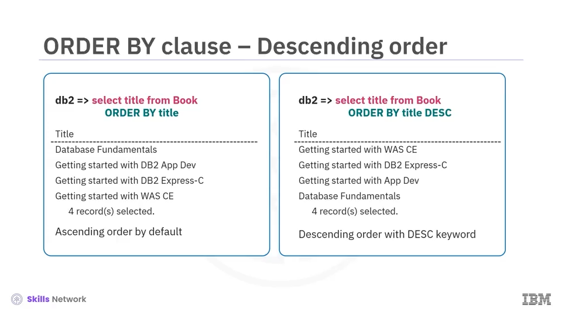

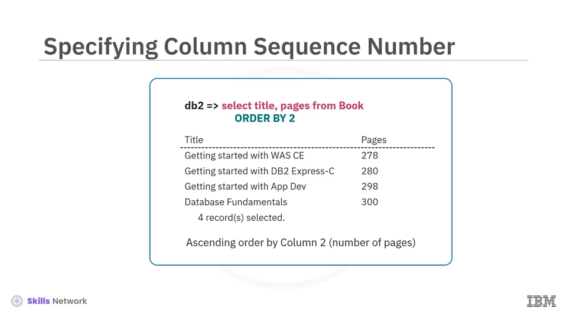

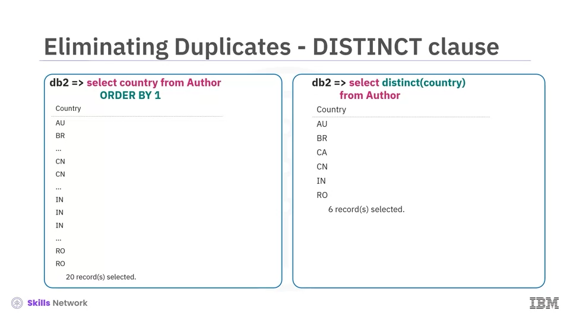

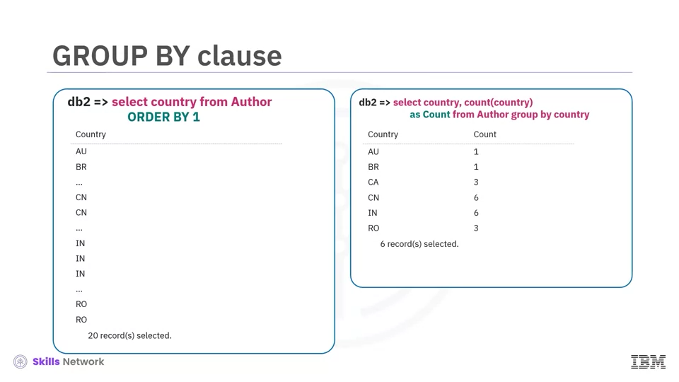

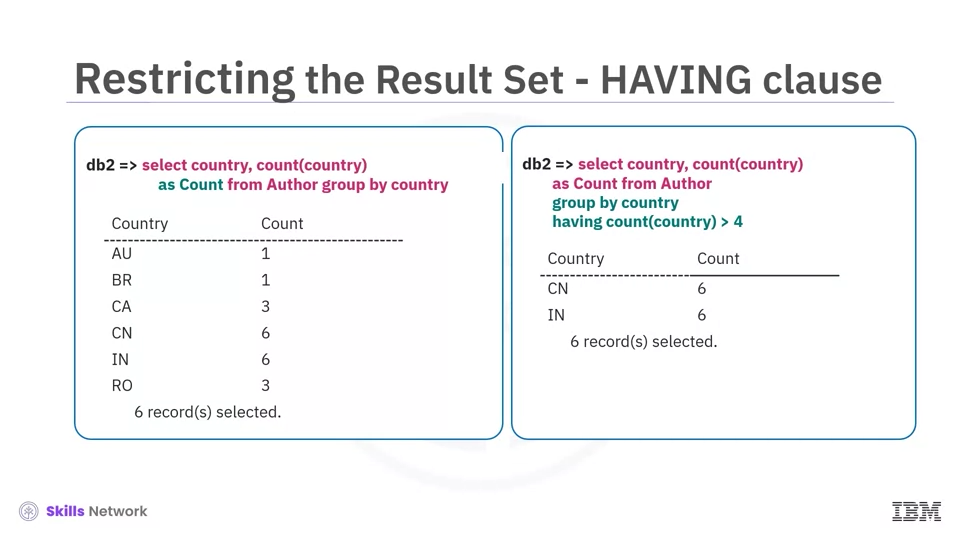

# Exercise

1️⃣Create tables:

CREATE TABLE EMPLOYEES (

EMP\_ID CHAR(9) NOT NULL,

F\_NAME VARCHAR(15) NOT NULL,

L\_NAME VARCHAR(15) NOT NULL,

SSN CHAR(9),

B\_DATE DATE,

SEX CHAR,

ADDRESS VARCHAR(30),

JOB\_ID CHAR(9),

SALARY DECIMAL(10,2),

MANAGER\_ID CHAR(9),

DEP\_ID CHAR(9) NOT NULL,

PRIMARY KEY (EMP\_ID)

);

CREATE TABLE JOB\_HISTORY (

EMPL\_ID CHAR(9) NOT NULL,

START\_DATE DATE,

JOBS\_ID CHAR(9) NOT NULL,

DEPT\_ID CHAR(9),

PRIMARY KEY (EMPL\_ID,JOBS\_ID)

);

CREATE TABLE JOBS (

JOB\_IDENT CHAR(9) NOT NULL,

JOB\_TITLE VARCHAR(30),

MIN\_SALARY DECIMAL(10,2),

MAX\_SALARY DECIMAL(10,2),

PRIMARY KEY (JOB\_IDENT)

);

CREATE TABLE DEPARTMENTS (

DEPT\_ID\_DEP CHAR(9) NOT NULL,

DEP\_NAME VARCHAR(15) ,

MANAGER\_ID CHAR(9),

LOC\_ID CHAR(9),

PRIMARY KEY (DEPT\_ID\_DEP)

);

CREATE TABLE LOCATIONS (

LOCT\_ID CHAR(9) NOT NULL,

DEP\_ID\_LOC CHAR(9) NOT NULL,

PRIMARY KEY (LOCT\_ID,DEP\_ID\_LOC)

);

2️⃣ Upload the csv files:

*   Departments.csv
*   Jobs.csv
*   JobsHistory.csv
*   Locations.csv
*   Employees.csv

3️⃣ String patterns

Say you need to retrieve the first names F\_NAME and last names L\_NAME of all employees who live in Elgin,IL. You can use the LIKE operator to retrieve strings that contain the said text. The code will look as shown below.

Note that in the first example, % sign is used both before and after the required text. This is to indicate, that the address string can have more characters, both before and after, the required text.

*   **LIKE** operator is used in a WHERE clause to search for a specified pattern in a column.Two wildcards often used in conjunction with the LIKE operator are percent sign(%) and underscore sign (\_), depending upon the SQL engine being used.

**SELECT F\_NAME, L\_NAME**

**FROM EMPLOYEES**

**WHERE ADDRESS LIKE '%Elgin,IL%';**

Result:

\*\*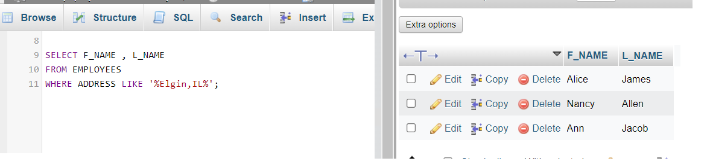\
\*\*

Now assume that you want to identify the employees who were born during the 70s. The query above can be modified to:

**SELECT F\_NAME, L\_NAME**

**FROM EMPLOYEES**

**WHERE B\_DATE LIKE '197%';**

In the second example, since the date of birth in EMPLOYEES records starts with the birth year, the % sign is applied after 197%, indicating that the birth year can be anything between 1970 to 1979. Further the % sign also allows any possible date throughout the selected years.

4️⃣Between

The BETWEEN operator selects values within a given range. The values can be numbers, text, or dates. The BETWEEN operator is inclusive: begin and end values are included.

Consider a more specific example. Let us retrieve all employee records in department 5 where salary is between 60000 and 70000. The query that will be used is:

**SELECT \* FROM EMPLOYEES**

**WHERE (SALARY BETWEEN 60000 AND 70000) AND DEP\_ID = 5;**

**5️⃣Grouping**

GROUP BY clause is used in collaboration with the SELECT statement to arrange data with identical values into groups.

NOTE: The SQL problems in this exercise involve usage of SQL Aggregate functions AVG and COUNT. COUNT has been covered earlier. AVG is a function that can be used to calculate the Average or Mean of all values of a specified column in the result set. For example, to retrieve the average salary for all employees in the EMPLOYEES table, issue the query: **SELECT AVG(SALARY) FROM EMPLOYEES;.**

A good example of grouping would be if For each department ID, we wish to retrieve the number of employees in the department.

**SELECT DEP\_ID, COUNT(\*)**

**FROM EMPLOYEES**

**GROUP BY DEP\_ID;**

Now, for each department, retrieve the number of employees in the department and the average employee salary in the department. For this, you can use COUNT(\*) to retrieve the total count of a column, and AVG() function to compute average salaries, and then GROUP BY.

**SELECT DEP\_ID, COUNT(\*), AVG(SALARY)**

**FROM EMPLOYEES**

**GROUP BY DEP\_ID;**

Label the computed columns in the result set of the last problem as NUM\_EMPLOYEES and AVG\_SALARY.

**SELECT DEP\_ID, COUNT(\*) AS "NUM\_EMPLOYEES", AVG(SALARY) AS "AVG\_SALARY"**

**FROM EMPLOYEES**

**GROUP BY DEP\_ID;**

You can also combine the usage of GROUP BY and ORDER BY statements to sort the output of each group in accordance with a specific parameter. It is important to note that in such a case, ORDER BY clause must be used after the GROUP BY clause. For example, we can sort the result of the previous query by average salary. The SQL query would thus become

*   ORDER BY keyword is used to sort the result-set in ascending or descending order. The default is ascending. In case of multiple columns in ORDER BY, the sorting will be done in the sequence of the appearance of the arguments.

**SELECT DEP\_ID, COUNT(\*) AS "NUM\_EMPLOYEES", AVG(SALARY) AS "AVG\_SALARY"**

**FROM EMPLOYEES**

**GROUP BY DEP\_ID**

**ORDER BY AVG\_SALARY;**

In case you need to filter a grouped response, you have to use the HAVING clause. In the previous example, if we wish to limit the result to departments with fewer than 4 employees, We will have to use HAVING after the GROUP BY, and use the count() function in the HAVING clause instead of the column label.

*   **HAVING** clause is used in conjunction with GROUP BY clause in collaboration with the SELECT statement in order to filter the data as per the given condition and then group as per identical values of a specified parameter.

**SELECT DEP\_ID, COUNT(*) AS "NUM\_EMPLOYEES", AVG(SALARY) AS "AVG\_SALARY"***

***FROM EMPLOYEES***

***GROUP BY DEP\_ID***

***HAVING count(\**) < 4**

**ORDER BY AVG\_SALARY;**

**\---------------------------------------------------------------------------------------------------------------------------------------------------------**

\*\*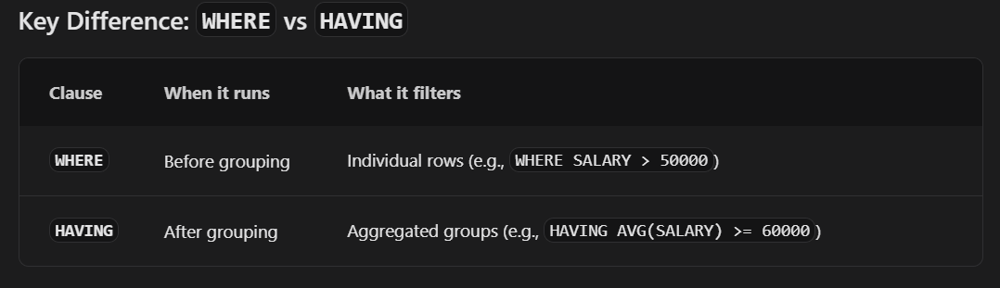\
\*\*

**Example:**

**select DEP\_ID, AVG(SALARY) AS "AVG\_SALARY"**

**from EMPLOYEES**

**GROUP BY DEP\_ID;**

**HAVING AVG(SALARY) >= 60000**

**ORDER BY AVG\_SALARY DESC;**

---

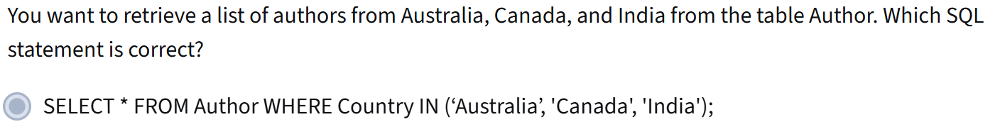

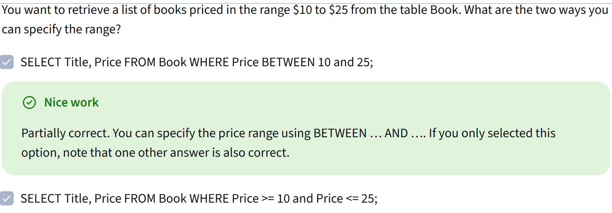
