# Built-in Functions

When compute these functions a columns is added with the calculations. It is possible name this new columm like in this example:

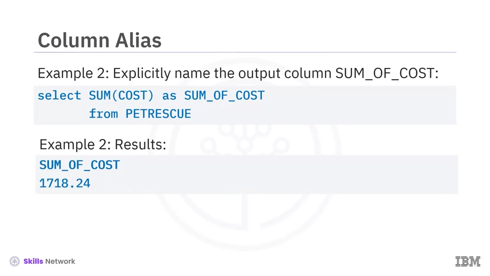\-

Also is possible to apply this functions to a sub set of data, for example:

*   Here the MIN will be just apply to animal = dog.

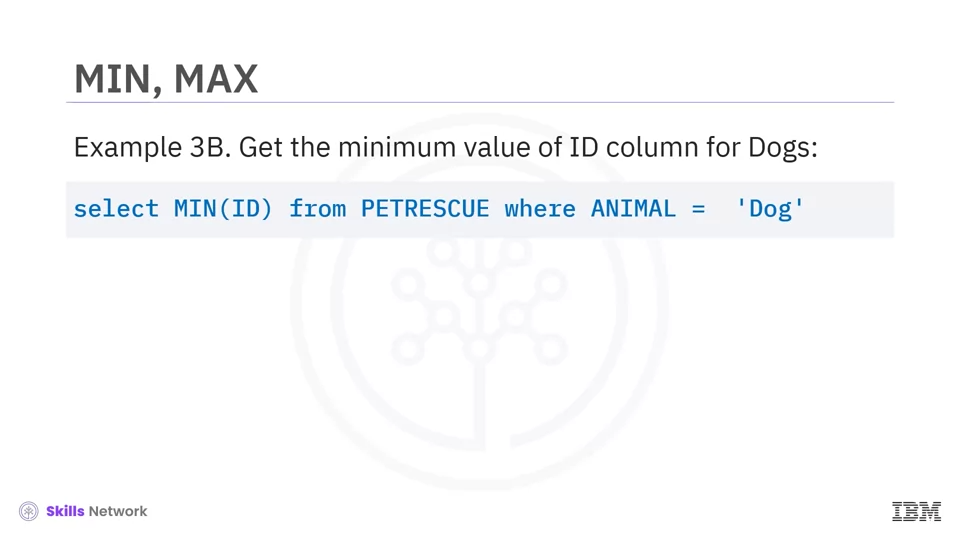

Also is possible to do calculations between columns and then apply these functions,

*   *   Here the AVG will be calculated after the calculation of COST / QUANTITY(in this case the cost if for multiply units so need to be divided), only for Dog (not all the animals);

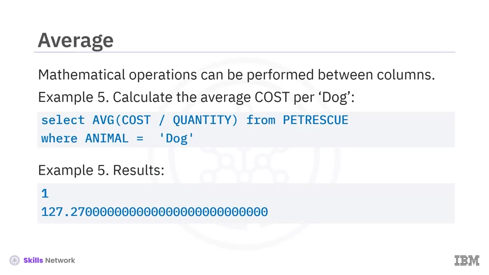

*   **COUNT**
    *   COUNT function returns the number of rows that match a specified criterion.
        *   **SELECT COUNT(column\_name) FROM table\_name WHERE condition;**
*   **AVG**
    *   The AVG function returns the average value of a numeric column.
        *   **SELECT AVG(column\_name) FROM table\_name WHERE condition;**
*   **SUM**
    *   The SUM function returns the total sum of a numeric column.
        *   **SELECT SUM(column\_name) FROM table\_name WHERE condition;**
*   **MIN**
    *   The MIN function returns the smallest value of the selected column.
        *   **SELECT MIN(column\_name) FROM table\_name WHERE condition;**
*   **MAX**
    *   The MAX function returns the largest value of the selected column.
        *   **SELECT MAX(column\_name) FROM table\_name WHERE condition;**
*   **ROUND**
    *   The ROUND function rounds a number to a specified number of decimal places.
        *   **SELECT ROUND(column\_name, decimals, operation) AS RoundValue;**
        *   **SELECT ROUND(COST, 2) FROM PETRESCUE; two decimal points.**
        *   **SELECT ROUND(COST) FROM PETRESCUE; zero decimal points.**
*   **LENGTH (string)**
    *   The LENGTH function returns the length of a string, in bytes.
        *   **SELECT LENGTH(column\_name) FROM table;** This will return the length of each row in the column.
*   **UCASE (string)**
    *   The UCASE function displays the column name in each table in uppercase.
        *   **SELECT UCASE(column\_name) FROM table;**
*   **LCASE (string)**
    *   The LCASE function displays the column name in each table in lowercase.
        *   **SELECT LCASE(column\_name) FROM table;**
*   **DISTINCT**
    *   The DISTINCT function is used to display data without duplicates.
        *   **SELECT DISTINCT column\_name FROM table;**

**Application of one function operated after another:**

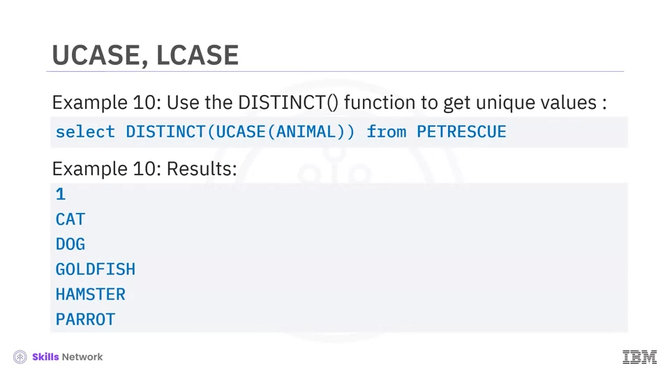\\

*   **DAY, TIME FUNCTIONS:**

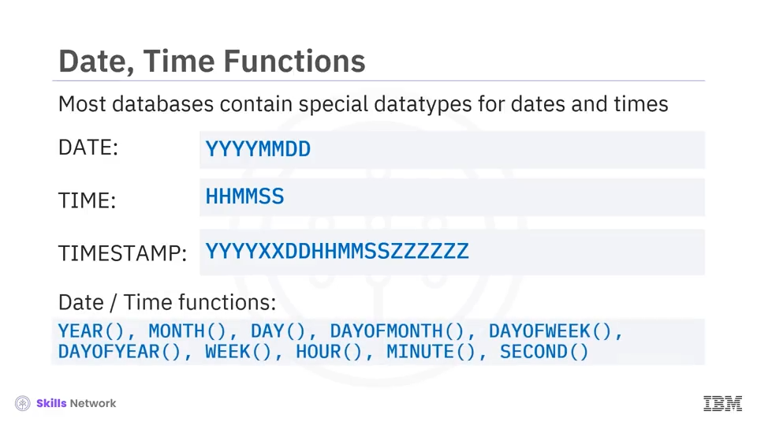\\

*   **DAY ===>This can be use for: YEAR(), MONTH()...**
    
    *   The DAY function returns the day of the month for a given date.
        *   **SELECT DAY(column\_name) AS marcelo** **FROM table**

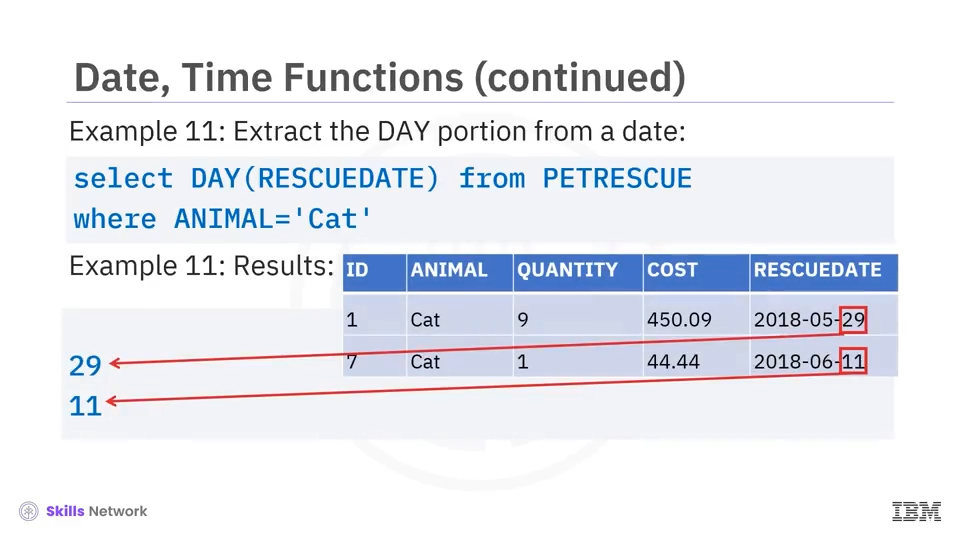

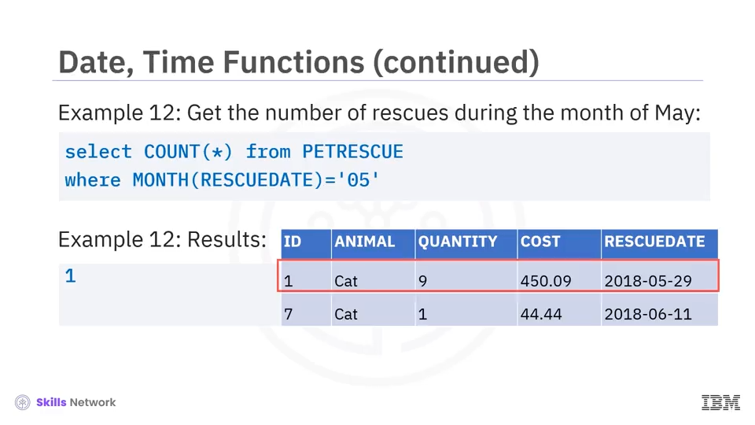

*   **CURRENT\_DATE**
    
    *   CURRENT\_DATE is used to display the current date in to an YYYY-MM-DD format, another function FROM\_DAYS(number\_of\_days)can be used. This function takes a number of days and returns the required formatted output. The query above would thus be modified to
    *   **SELECT FROM\_DAYS (DATEDIFF(CURRENT\_DATE, RESCUEDATE)) AS marcelo FROM PETRESCUE**;
*   **DATEDIFF()**
    
    *   DATEDIFF() is used to calculate the difference between two dates or time stamps.
    *   This function calculates the difference between the two given dates and gives the output in number of days.\\
        *   **SELECT DATEDIFF(date1, date2) AS marcelo;**

\*\*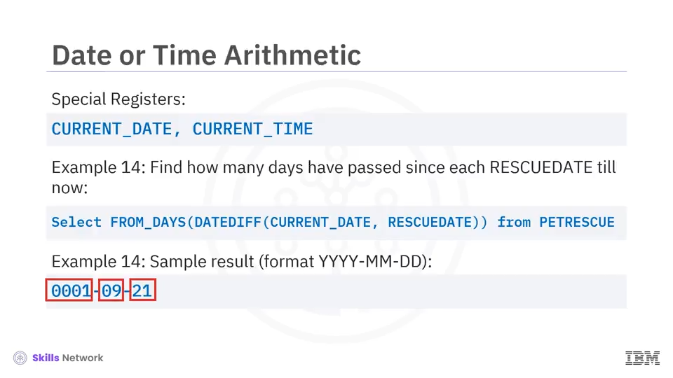

*   **FROM\_DAYS()**
    
    *   FROM\_DAYS() is used to convert a given number of days to YYYY-MM-DD format.
        *   **SELECT FROM\_DAYS(number\_of\_days) AS marcelo;**
*   **DATE\_ADD()**
    
    *   DATE\_ADD() is used to calculate the date after lapse of the mentioned number of units of date type. For example, if n = 3 and type = DAY, the result is a date 3 days after what is mentioned in the date column. The type variable can also be months or years.
        *   **SELECT DATE\_ADD(date, INTERVAL n type) AS marcelo;**

\*\*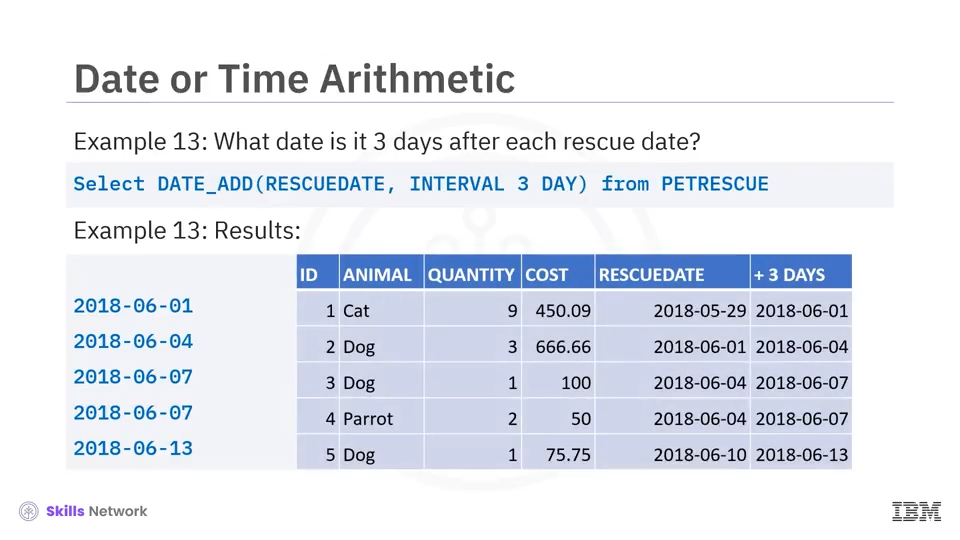\
\*\*

*   **DATE\_SUB**
    
    *   Similarly, we can retrieve a date before the one given in the column by a given number using the function DATE\_SUB. By modifying the same example, the following query would provide the date 3 days before the rescue.
    *   **SELECT DATE\_SUB(RESCUEDATE, INTERVAL 3 DAY) FROM PETRESCUE;**

# Sub Queries & Nested Selects

*   **SUBQUERY**
    
    *   A subquery is a query within another SQL query and embedded within the WHERE clause. This is to by pass an error because WHERE will not fuction.
        
    *   So to solve this we use a sub-querie with the WHERE.
        
    *   A subquery is used to return data that will be used in the main query as a condition to further restrict the data to be retrieved.
        
        *   **SELECT column\_name \[, column\_name \] FROM table1 \[, table2 \] WHERE column\_name OPERATOR (SELECT column\_name \[, column\_name \] FROM table1 \[, table2 \] \[WHERE\])**
            
        *   Example 1: SELECT emp\_id, f\_name, l\_name, salary FROM employeeswhere salary< (SELECT AVG(salary) FROM employees);
            
        *   Example 2: SELECT \* FROM ( SELECT emp\_id, f\_name, l\_name, dep\_id FROM employees) AS emp4all;
            
        *   Example 3: SELECT \* FROM employees WHERE job\_id IN (SELECT job\_ident FROM jobs);
            
        *   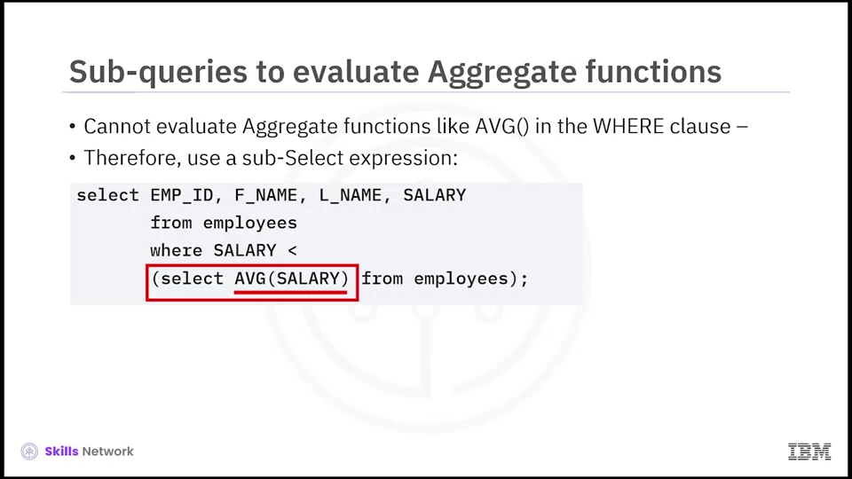
            
        *   Sub-queries can also be specify before:
            
        *   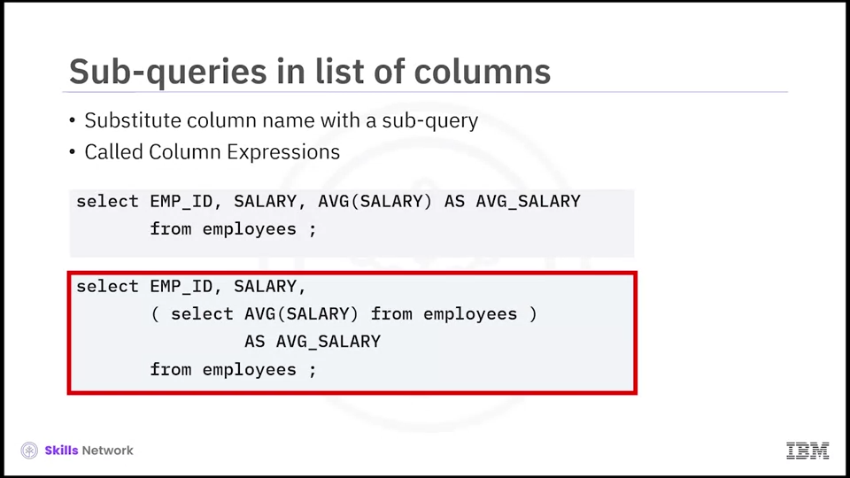
            
        *   Also there is the option of select something form a previous selection:
            
        *   In this example all will be selected follow the specification. Here is a simple example, but this can be usefull when working with several differents tables.
            
        *   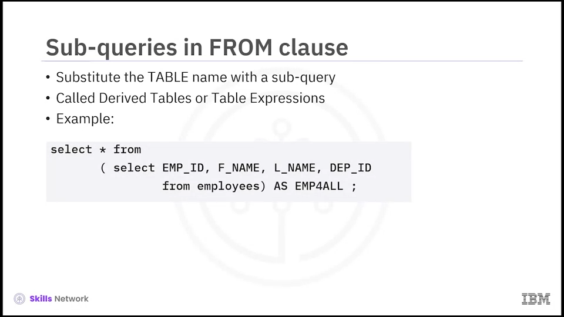
            
    *   **MULTIPLE TABLES with SUB-QUERIES**
        
        *   **Examples tables:**
        *   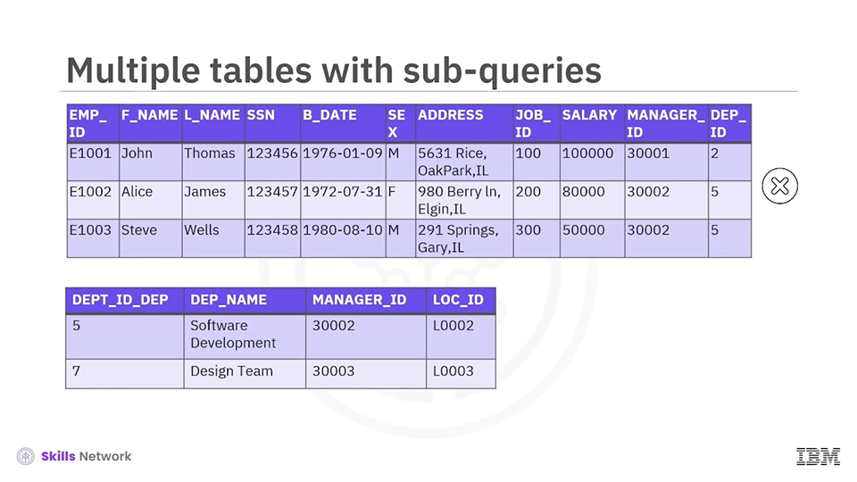
    *   **I want to** **retrieves all employees who work in a department located at L0002.**
        
        *   **SELECT \* FROM EMPLOYEES**
            
            *   **WHERE DEP\_ID IN (**
                *   **SELECT DEPT\_ID\_DEP FROM DEPARTMENT WHERE LOC\_ID = 'L0002'**
        *   **);**
            
        *   **EXPLANATION:**
            
            ---
            
            ```
            Even though they have different names (DEP\_ID in the EMPLOYEES table and DEPT\_ID\_DEP in the DEPARTMENT table), they represent the same concept (the Department ID). So this is use to link the tables. How the Link Works The Foreign Key: DEP\_ID in the EMPLOYEES table is a Foreign Key. It points to the Primary Key (DEPT\_ID\_DEP) in the DEPARTMENT table.
            
            **
            ```
            
            *   **The Inner Query (Sub-query)**
                
                *   **What it does: It looks at the DEPARTMENT table and finds the department ID(s) where the location ID is 'L0002'.**
                    
                *   **From your image: The department with LOC\_ID = 'L0002' is Software Development, which has DEPT\_ID\_DEP = 5.**
                    
                *   **Result: It returns a list of IDs in the department 5.**
                    
            *   **The Outer Query**
                
                *   **What it does: It looks at the EMPLOYEES table and keeps only the rows where the DEP\_ID matches one of the IDs returned by the sub-query.**
                    
                *   **Result: It returns all employees who have DEP\_ID = 5**
                    
        *   **Resutl:**
            
            *   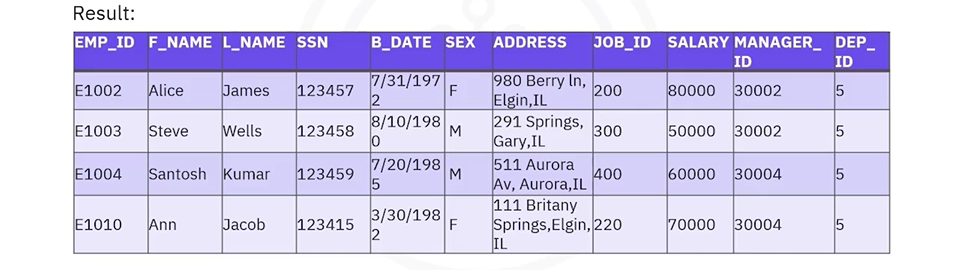
            *   Note it should be only 2 rows, but the course put this one, the important is that only employees wtih DEP\_ID = 5 are show.
    *   Ok, now I want to retrive the deparment name/DEP\_NAME from departments, but having in account the employees that make >70000, so I have to look first in the employees table:
        
    *   **SELECT DEP\_ID\_DEP, DEP\_NAME FROM DEPARMENTS**
        
    *   **WHERE DEPT\_ID\_DEP IN**
        
    *   **(SELECT DEP\_ID FROM EMPLOYEES WERE SALARY>70000);**\\
        
        *   The Inner Query (Sub-query):
            *   (select DEP\_ID from employees where SALARY >70000)
            *   This querie will run first.
        *   The Outer Query:
            *   select DEP\_ID, DEP\_NAME from departments where DEPT\_ID\_DEP IN
            *   After the employees that make more than 70k are found, now is time to look to what deparment the belong.
*   **ACCESSING MULTIPLE TABLES USING JOINS**
    
*   **USING JOINS IS EASY IT MEANS THAT YOU JOINS TALBES BASED IN THEIR KEYS, PRIMARY KEY AND FOREING KEY. YOU NEED TO CALL THIS TO LINK**
    
    *   **FULL JOIN**
        
        *   It is when I join 2 or more tables and all the columns are put together( idk if this is rigth the AI said that is not but the course said is this way)
            
            *   **SELECT \* FORM EMPLOYEES, DEPARTMENT**
                
            *   **WHERE EMPLOYEES.DEP\_ID = DEPARTMENTS.DEPT\_ID\_DEP;**
                
    *   **INNER JOIN**
        
        *   An inner join combines two or more records but displays only matching values in both tables. Inner join applies only the specified columns.
            *   Here we specify 2 tables = join
            *   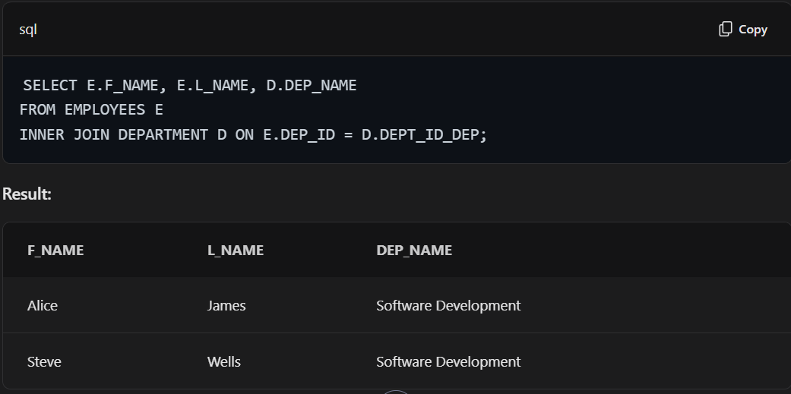
            *   Here the result only show what is in the 2 tables only, wathever is not represented in both tables is exclude.
    *   **CROSS JOIN**
        
        *   An implicit cross join is defined as a Cartesian product where the number of rows in the first table is multiplied by the number of rows in the second table.
            *   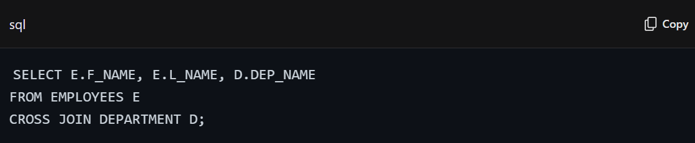
            *   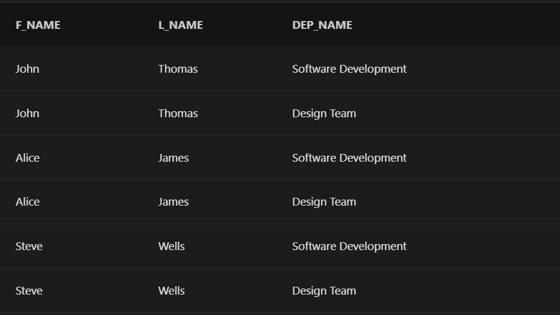
            *   This is a simple multiplication=> 3 Employees × 2 Departments = 6 Rows.

# Practice exercise

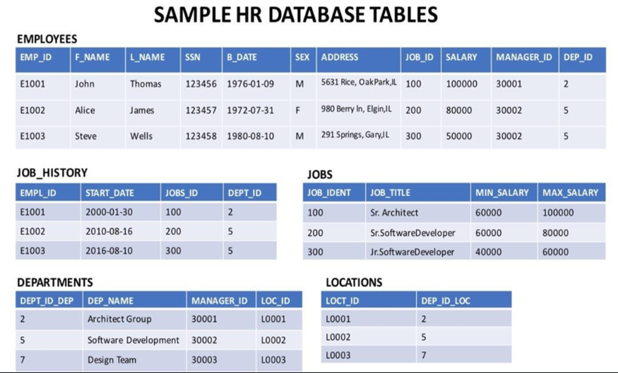

### 1- Retrieve only the EMPLOYEES records corresponding to jobs in the JOBS table.

### For this I have to look first to JOBS table and use it as a inner sub-query. Then the outer-query will select all the employess from EMPLOYEES.

### Inner query => JOB\_ID IN (SELECT JOB\_IDENT FROM JOBS);

### Outer query => SELECT \* FROM EMPLOYEES WHERE

### \------------ SELECT \* FROM EMPLOYEES WHERE JOB\_ID IN (SELECT JOB\_IDENT FROM JOBS);--------------

### Note: also this can be achive with JOIN but here the difference =>

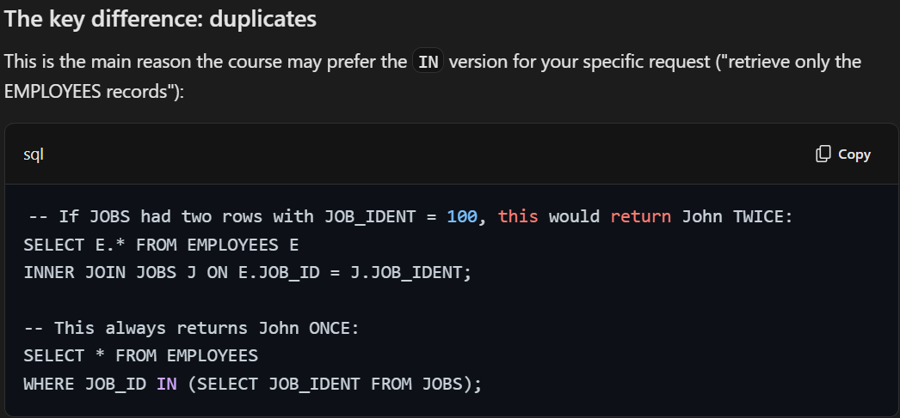

Note: Idk what AI put E.\* to select all the records from EMPLOYEES but I run it like this and it worked=> SELECT \* FROM EMPLOYEES E INNER JOIN JOBS J ON E.JOB\_ID = J.JOB\_IDENT;

### 2 - Retrieve JOB information for employees earning over $70,000.

### For this example, retrieve the details from the JOBS table for employees that make more 70K, then Join with the details in the EMPLOYEES table, they join in JOB\_ID:


### 3 - Retrieve only the EMPLOYEES records corresponding to jobs in the JOBS table.

### The same question as before, but now we will use Implicit Join to retrieve the required information. For this, you will combine the tables based on job IDs. Using the following query for this:

*   *   **SELECT \***
    *   **FROM EMPLOYEES, JOBS**
    *   **WHERE EMPLOYEES.JOB\_ID = JOBS.JOB\_IDENT;**
    *   \*\*\
        \*\*
    *   **SHORT VERSION:**
    *   \*\*\
        \*\*
    *   **SELECT \***
    *   **FROM EMPLOYEES E, JOBS J**
    *   **WHERE E.JOB\_ID = J.JOB\_IDENT;**

### **4 -** In the previous query, retrieve only the Employee ID, Name, and Job Title:

*   *   **SELECT EMP\_ID,F\_NAME,L\_NAME, JOB\_TITLE FROM**
    *   **EMPLOYEES E, JOBS J**
    *   **WHERE E.JOB\_ID = J.JOB\_IDENT;**

### **5 -** Retrieve only the list of employees whose JOB\_TITLE is Jr. Designer. This is a sub-query solution:

*   *   **SELECT \* FROM EMPLOYEES**
    *   **WHERE JOB\_ID IN**
    *   **(SELECT JOB\_IDENT FROM JOBS WHERE JOB\_TITLE= 'Jr. Designer');**
    *   **\
        **
*   **SAME BUT USING JOINS:**
    *   **\
        **
    *   **SELECT \* FROM EMPLOYEES E, JOBS J**
    *   **WHERE E.JOB\_ID = J.JOB\_IDENT**
    *   **AND J.JOB\_TITLE= 'Jr. Designer'; //Here AND is add as filter <=**

### **6 -** Retrieve JOB information and a list of employees whose birth year is after 1976. So here I have to retrive all columns from JOB table but only for employees that date of birth is > 1976, this info is in the EMPLOYEES table. This can be written as a sub-query and a Join, here is only the Join version, that look easy. AND is add a condition to filter by date of birth.

*   *   **SELECT J.JOB\_TITLE, J.MIN\_SALARY, J.MAX\_SALARY, J.JOB\_IDENT**
    *   **FROM JOBS J, EMPLOYEES E**
    *   **WHERE E.JOB\_ID = J.JOB\_IDENT**
    *   **AND YEAR(E.B\_DATE)>1976;**
