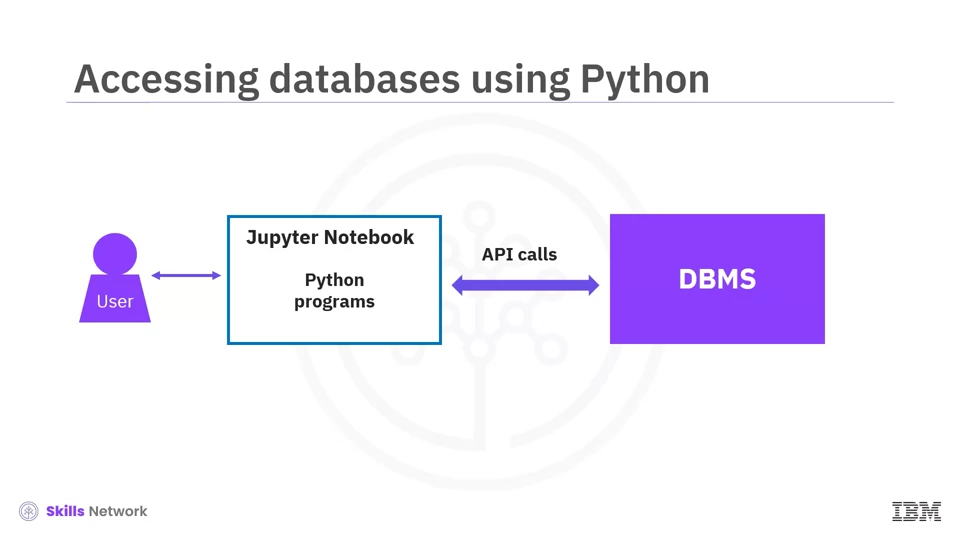
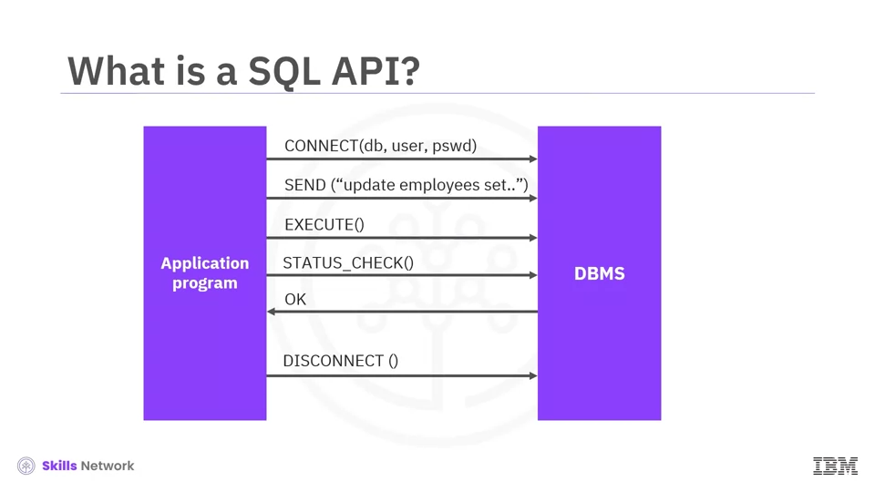
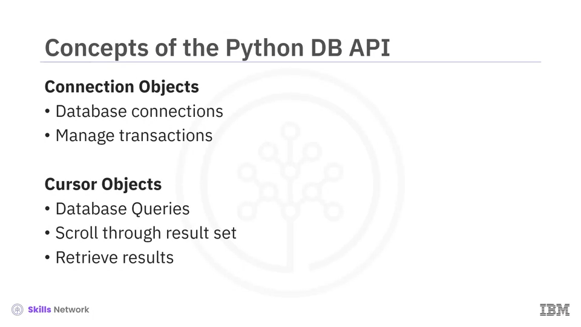
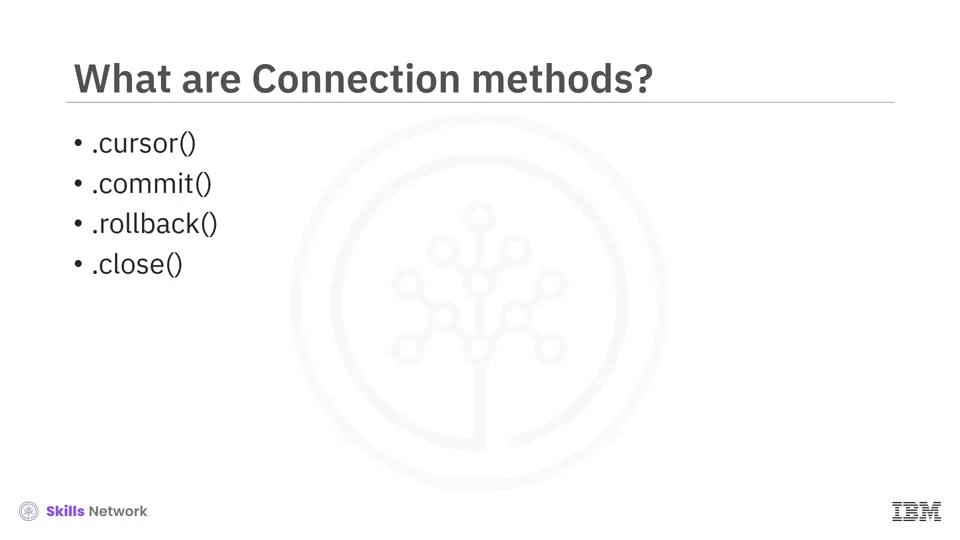
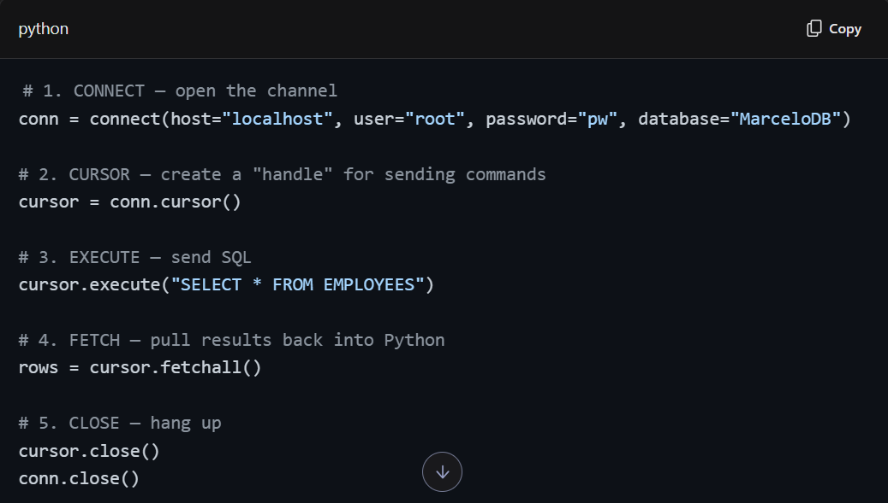
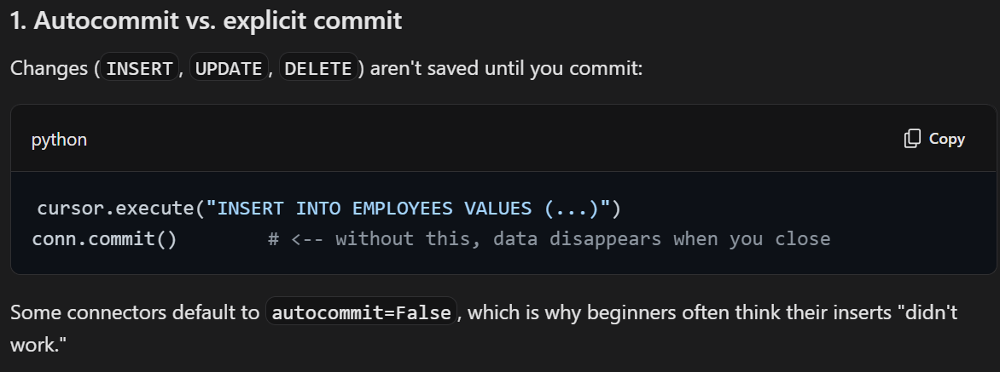
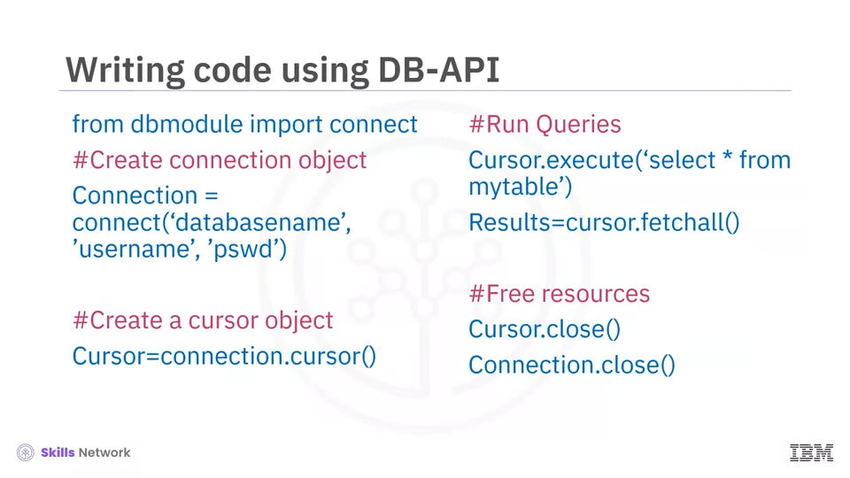

# Data Base & Python









## What are connection methods?

### In Python, a database is a separate program (MySQL, PostgreSQL, SQLite) running outside your script. Python can't touch its files directly — it must talk to that server over a protocol. A connection method is the library/function that opens and manages that communication channel.

### Think of it like making a phone call: you need a phone (the library), a number (host/database), credentials (user/password), and then you can talk (execute queries).

## The universal workflow

### Almost every connection method follows these same 6 steps:







# FULL WORK FLOW

## Part 1: Install MySQL Server

1.  Go to https://dev.mysql.com/downloads/installer/
2.  Download MySQL Installer for Windows (mysql-installer-community-...msi)
3.  Run it and choose "Server only" (or "Developer Default" if you want tools too)
4.  Important: during setup you'll be asked to:
    1.  Set a root password → write this down, you'll need it everywhere
    2.  Configure as Windows Service → leave default (MySQL80)
    3.  Port → leave 3306
    4.  Finish installation
5.  Verify the server is running:
    1.  Open Command Prompt:
        1.  Run: **sc query MySQL80**
            1.  You want **STATE : 4 RUNNING.** If not:
        2.  Run: **net start MySQL80**

## Part 2: Install the Python connector

1.  In your environment Marcelo31
    1.  Run:
        1.  **conda install -c conda-forge mysql-connector-python tabulate**
    2.  Verification\*\*:\*\*
        1.  **import mysql.connector**
        2.  **print(mysql.connector.**version**)**

## Part 3: Connect to the MySQL server

```python
import mysql.connector
from tabulate import tabulate
Step 1: Connect to the SERVER (no database= argument yet)
connect = mysql.connector.connect(
host="localhost",
port=3306,
user="root",
password="your_root_password"     # <-- the one you set during install
)
print("Connected to MySQL server:", conn.get_server_info()
```

# Part 4: Create the database

```python
cursor = connect.cursor()//Connect with the database with coursor 
Step 2: Create the database (IF NOT EXISTS makes re-runs safe)
cursor.execute("CREATE DATABASE IF NOT EXISTS MarceloDB")
Step 3: Tell the connection to USE it
cursor.execute("USE MarceloDB")
Optional: confirm it exists
cursor.execute("SHOW DATABASES")
print([db[0] for db in cursor.fetchall()])
```

# Part 5: Create the EMPLOYEES table

```python
Step 4: Drop if exists (dev only!) then create
cursor.execute("DROP TABLE IF EXISTS EMPLOYEES")
create_sql = """
CREATE TABLE EMPLOYEES (
EMP_ID      VARCHAR(10) PRIMARY KEY,
F_NAME      VARCHAR(50) NOT NULL,
L_NAME      VARCHAR(50) NOT NULL,
SSN         CHAR(9),
B_DATE      DATE,
SEX         CHAR(1),
ADDRESS     VARCHAR(100),
JOB_ID      INT,
SALARY      DECIMAL(10,2),
MANAGER_ID  INT,
DEP_ID      INT
)
"""
cursor.execute(create_sql)
print("Table created.")
Confirm structure
cursor.execute("DESCRIBE EMPLOYEES")
print(tabulate(cursor.fetchall(),
headers=["Field","Type","Null","Key","Default","Extra"],
tablefmt="grid"))
```

# Part 6: Insert data

```python
Step 5: Insert rows using parameterized queries (safe from SQL injection)
employees = [
("E1001", "John",  "Thomas", "123456", "1976-01-09", "M", "5631 Rice, OakPark,IL", 100, 100000, 30001, 2),
("E1002", "Alice", "James",  "123457", "1972-07-31", "F", "980 Berry In, Elgin,IL", 200,  80000, 30002, 5),
("E1003", "Steve", "Wells",  "123458", "1980-08-10", "M", "291 Springs, Gary,IL",   300,  50000, 30002, 5),
]
insert_sql = """
INSERT INTO EMPLOYEES
(EMP_ID, F_NAME, L_NAME, SSN, B_DATE, SEX, ADDRESS, JOB_ID, SALARY, MANAGER_ID, DEP_ID)
VALUES (%s, %s, %s, %s, %s, %s, %s, %s, %s, %s, %s)
"""
cursor.executemany(insert_sql, employees)     # bulk insert — much faster than looping
print(f"{cursor.rowcount} rows inserted.")
```

# Part 7: Commit the changes

```python
Step 6: Persist the writes — WITHOUT THIS YOUR DATA DISAPPEARS
conn.commit()
print("Changes committed.")
```

# Part 8: Fetch and display all data

```python
Step 7: Query everything
cursor.execute("SELECT * FROM EMPLOYEES ORDER BY L_NAME")
rows = cursor.fetchall()
Pull column names automatically instead of hard-coding them
columns = [col[0] for col in cursor.description]
Step 8: Print nicely formatted to the notebook output / terminal
print(tabulate(rows, headers=columns, tablefmt="grid"))
```

# Part 9: Close everything

```python
Step 9: Clean shutdown
cursor.close()
conn.close()
print("Connection closed.")
```
